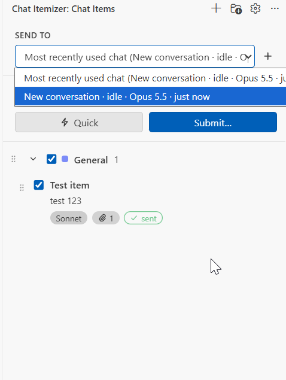

# Claude Chat Itemizer

**Write your Claude Code prompts ahead of time, give each one its own attachments, model and effort, then send one, some or all of them into a Claude Code chat in VS Code.**

[](https://github.com/ameralqarallih-lgtm/claude-chat-itemizer/releases/latest)
[](LICENSE)




- [What it does](#what-it-does)
- [Requirements](#requirements)
- [Installation](#installation)
- [Guide](#guide)
- [What each item can set](#what-each-item-can-set)
- [How it works](#how-it-works)
- [Troubleshooting](#troubleshooting)
- [Building from source](#building-from-source)
- [Releases](#releases)

## What it does

| | |
| --- | --- |
| **Chat items** | A prompt, a title, attachments, and its own chat settings. Write them whenever ideas come up and send them later. |
| **Categories** | Group items, color them, give a whole category its own settings. Drag items to reorder them or move them between categories. |
| **Attachments** | Add files with a picker, drag them in, or press **Ctrl+V** to paste a screenshot, copied files or text. |
| **Per-item settings** | Model, effort, tool policy and hidden instructions, each inherited from the defaults or the category unless the item sets its own. |
| **Send to** | Pick which open Claude chat receives your items, or let it follow the chat you used last. |
| **Three ways to send** | One conversation in order, a new conversation per item, or every item in one message. **Quick** sends with the chat's own settings, no questions asked. |
| **Run history** | Every submission, grouped into Running, Today, Yesterday and Earlier, with each item's status, the model that answered and a preview of the reply. |
| **Export / import** | Move your items, with their attachments, between machines or workspaces as one JSON file. |

## Requirements

- **VS Code 1.90 or newer.**
- **The Claude Code extension for VS Code**, version 2.1.311 or newer, signed in.
- **A folder or workspace open in VS Code.** Items and attachments are stored per workspace.

## Installation

The Itemizer has two parts, and you install both:

| Part | What it is | Why it's needed |
| --- | --- | --- |
| **Chat Itemizer** | A VS Code extension: the sidebar, editor and storage. | The UI you work in. |
| **itemizer-bridge** | A Claude Code plugin that runs inside each Claude chat. | The Claude Code extension has no way for another extension to send a message into its chat. The plugin does it from the inside. |

### 1. Install the VS Code extension

1. Download `claude-chat-itemizer-0.3.0.vsix` from the [latest release](https://github.com/ameralqarallih-lgtm/claude-chat-itemizer/releases/latest).
2. Install it, either:
   - from the command line: `code --install-extension claude-chat-itemizer-0.3.0.vsix`
   - or in VS Code: **Extensions** view → **⋯** menu → **Install from VSIX…** → pick the file.
3. Reload VS Code if it asks. A **Chat Itemizer** icon appears in the activity bar.

### 2. Set up the Claude bridge

1. Open the **Chat Itemizer** view.
2. Click **Set Up Claude Bridge** in the banner, then **Set Up** in the dialog. This:
   - copies the plugin to `~/.claude/itemizer/plugin`;
   - adds `CLAUDE_CODE_PLUGIN_DIRS` to the user setting `claudeCode.environmentVariables`, so Claude tabs load the plugin.
3. Click **Open Claude Tab**. Claude tabs that were already open don't load the plugin, so close them or open new ones.

The sidebar footer shows **1 Claude chat connected** once the bridge reports in, usually within a few seconds.

<details>
<summary><b>Alternative: install the plugin from this repository's marketplace</b></summary>

For a Claude session in a terminal, or if you manage plugins yourself, type this at the Claude Code prompt:

```text
/plugin install itemizer-bridge --marketplace ameralqarallih-lgtm/claude-chat-itemizer
```

Answer `y` to add the marketplace, then pick the user scope. The extension still has to be installed for anything to be sent: the plugin stays dormant in folders where no Itemizer window is open.

</details>

### Updating

Install the new VSIX the same way. When the bridge is already set up, the extension refreshes the plugin copy on its next start. New Claude tabs pick up the new plugin; open ones keep the old one until you reopen them.

### Uninstalling

1. Run **Chat Itemizer: Remove Claude Bridge** from the Command Palette. It removes the plugin copy and its `CLAUDE_CODE_PLUGIN_DIRS` entry.
2. Uninstall the extension from the Extensions view.

## Guide

### Write chat items

- **New item:** the **＋** in the view's title bar, or the **＋** that appears when you hover over a category header. The editor opens next to your code.
- **In the editor:** give the item a title (optional, shown in the list) and a prompt. Changes save as you type.
- **In the list:** each item shows its title, the first line of its prompt, and small labels for its model, effort, attachment count and tool policy.
  - **Plain labels:** the value comes from the defaults.
  - **Dashed labels:** the value comes from the category.
  - **Highlighted labels:** the item sets the value itself.

### Organize them

- **Categories:** **New Category** in the title bar. Click a category's name, or the ⚙ on hover, to rename it, change its color or give it settings. Deleting a category moves its items to another one.
- **Reorder:** drag an item by its handle (⋮⋮) within a category, or drop it on another category. Category headers drag the same way. With the keyboard, focus a handle, press Space, move with the arrow keys, and press Space again.
- **Hover actions:** ⚡ Quick send, Duplicate, Delete.
- **Hide sent items:** the 👁 toggle hides items you've already sent. Each category says how many are hidden, with a **Show** link.

### Add attachments

In the item editor's attachment area:

| How | What you get |
| --- | --- |
| **Add files…** | Any file, through the file picker. |
| **Drag and drop** | Files from your file manager. From VS Code's Explorer, hold **Shift** while dropping. |
| **Ctrl+V** in the attachment area | A screenshot on the clipboard becomes `pasted-image-N.png`. Files copied in Explorer become attachments. Plain text becomes `pasted-text-N.txt`. |
| **Ctrl+V** in the prompt box | An image is attached; text pastes into the prompt as usual. |

Attachments are stored as copies in the workspace's private VS Code storage, so later edits to the original don't change what you send. Click an attachment's thumbnail to open it.

### Choose where items go

**Send to**, at the top of the sidebar, lists the Claude chats open in this window's folder. Each shows its title, whether it's working or idle, its model, and when it was last used.

- **Most recently used chat** (the default) follows whichever chat you used last.
- **Pick a specific chat** to pin it. The choice is remembered for this workspace. If that chat is closed, sending stops with a message, so items never go to a different chat by surprise.
- **＋** opens a new Claude tab.

### Send them

Tick the items you want, then:

- **⚡ Quick** sends them to the **Send to** chat, in list order, using **that chat's** current model and effort. Item settings are ignored; attachments are still sent. The ⚡ on a single item does the same for that item.
- **Submit…** opens a dialog:

| Mode | What happens |
| --- | --- |
| **One conversation, in order** | Each item is its own message, sent after Claude finishes replying to the previous one. Each uses its own model and effort. |
| **New conversation per item** | Opens a new Claude tab for each item, with 1 to 4 running at once. |
| **All in one message** | Joins the items into one prompt with numbered headings and all their attachments. It's one turn, so it uses one set of settings: the first item's, or the defaults. |

Dialog options:
- **Stop on first failure**
- **Send the title as a heading**
- **Hide items after they're sent**

The dialog also warns about anything that won't apply exactly as set, such as an effort level a model doesn't support.

Sent items appear in the chat as your own messages, followed by `Attached: …` when they carry files.

### Follow and control runs

The **Runs** section above your items lists every submission. The section, each group (Running, Today, Yesterday, Earlier) and each run can be collapsed, and the view remembers what you opened.

- **A running run** shows progress, plus:
  - **Stop:** ends the current item and cancels the rest;
  - **Cancel:** lets the current item finish, then cancels the rest.
- **An expanded run** lists each item with:
  - its status;
  - the model that actually answered;
  - the first line of the reply, or the error.

  Click an item's name to open it, or **Select these items** to send them again.
- **Remove runs** one at a time with ×, or all at once with **Clear finished**.

### Defaults, export and import

- **Defaults** (⚙ in the title bar): the settings every item starts with.
- **Export Items… / Import Items…** (in the **⋯** menu): one JSON file with your items, categories and attachments. Importing either adds to what you have, merging categories by name, or replaces it.

## What each item can set

Settings resolve in three layers, **Defaults → Category → Item**. The editor shows where each value comes from, and **Reset** removes an override.

| Setting | Per item | How it's applied |
| --- | :---: | --- |
| **Model** | ✅ | Switched for that item's turn only, then the chat goes back to its own model. Subagents keep theirs. |
| **Effort** (Low … Max) | ✅ | Same as the model. Dropped with a warning when the model doesn't support that level. |
| **Text attachments** | ✅ | Their contents are given to Claude with the prompt. |
| **Images and PDFs** | ✅ by path | Claude opens them with its Read tool, which the bridge allows for exactly those files without asking you. |
| **Tool policy** | ✅ | **Read-only** refuses file edits and asks before shell commands. **Auto-accept edits** approves edits inside the workspace, and only when the `claudeItemizer.allowLooseningPolicies` setting is on. |
| **Instructions** | ✅ | Hidden text sent along with the prompt, such as "answer in German". |
| **Permission mode, thinking on/off, fast mode, output style** | ❌ | These belong to the Claude tab. Effort is the lever for how hard Claude thinks. |

### Why images go in as paths

Claude Code lets a plugin send text only: an image can't be embedded in a message a plugin sends, and the Claude Code extension doesn't let another extension add attachments to its chat. So the bridge tells Claude where each image or PDF is, and allows Claude's Read tool to open exactly those files. Claude opens them before answering. In the chat they appear as a Read step, not as a thumbnail on your message.

## How it works

```text
 VS Code window                                         ~/.claude/itemizer/v1
┌─────────────────────────────┐   inbox/<batch>.json   ┌──────────────────────────────┐
│ Chat Itemizer extension     │ ─────────────────────▶ │ itemizer-bridge plugin       │
│  sidebar · editor · storage │   control.json         │  (runs inside each Claude    │
│                             │ ◀───────────────────── │   chat in this folder)       │
│                             │   presence.json        │                              │
│                             │   outbox/<batch>.json  │  sends each item as a turn,  │
└─────────────────────────────┘                        │  sets its model and effort   │
                                                       └──────────────────────────────┘
```

1. **The extension writes a heartbeat** listing the folders open in this window. A bridge plugin in a Claude chat in one of those folders wakes up and writes a **presence** file. That's how the chat appears in **Send to**.
2. **Sending an item** writes a **batch** file to that chat's inbox. The plugin picks it up within a second.
3. **When the chat is idle,** the plugin:
   - adds the attachment context;
   - sends the prompt as if you had typed it;
   - ties the next turn to the item.
4. **While that turn runs,** Claude Code hooks apply the item's model and effort to each request (`turn.step`) and its tool policy to each tool call (`tool.check`).
5. **When the turn ends,** the plugin writes the result to its outbox, and the run history updates.

Every file has a single writer. The extension writes atomically. The plugin never deletes anything; the extension cleans up finished batches. The file formats are defined in [`packages/bridge-plugin/hooks/protocol.ts`](packages/bridge-plugin/hooks/protocol.ts).

### Settings

| Setting | Default | What it does |
| --- | --- | --- |
| `claudeItemizer.bridgeDirectory` | `~/.claude/itemizer/v1` | Folder the two parts exchange files through. Run **Set Up Claude Bridge** again after changing it. |
| `claudeItemizer.newConversation.strategy` | `openAndClaim` | How **New conversation per item** starts each conversation:<br>• `openAndClaim`: automatic;<br>• `pressEnter`: opens each tab with `/itemizer-run …` typed in for you to send. |
| `claudeItemizer.newConversation.timeoutSeconds` | `25` | How long to wait for a new tab before falling back to press-Enter. |
| `claudeItemizer.settleMs` | `800` | Pause between items of a batch. |
| `claudeItemizer.allowLooseningPolicies` | `false` | Allows the **Auto-accept edits** tool policy. |
| `claudeItemizer.modelCatalogOverrides` | `[]` | Adds models to the picker, or corrects which effort levels one supports. |

## Troubleshooting

| Problem | Fix |
| --- | --- |
| **"No Claude chat connected"** | Open a **new** Claude tab: tabs opened before the bridge was set up don't load it. Check that the tab's folder is the one open in VS Code. |
| **A chat is missing from Send to** | Same as above. Chats appear only in the folder they run in, and only while their tab is open. |
| **An item says "waiting for the Claude chat to start it"** | The chat isn't processing prompts, usually because its tab is closed. Press **Stop** in the run and send the item to another chat. |
| **"The chat picked in Send to is closed"** | Pick another chat in **Send to**, or choose **Most recently used chat**. |
| **The model didn't change** | Quick submit keeps the chat's model by design. Use **Submit…** and give the item its own model. |
| **The Set Up banner keeps returning** | The `claudeCode.environmentVariables` entry was removed or edited. Run **Set Up Claude Bridge** again. |
| **Something else** | **Chat Itemizer: Show Log** opens the extension's log. The bridge's files are in `~/.claude/itemizer/v1/sessions/<chat id>/`. |

## Building from source

Requires Node.js 20+ and npm.

```sh
git clone https://github.com/ameralqarallih-lgtm/claude-chat-itemizer.git
cd claude-chat-itemizer
npm install
npm run build        # extension host and webview bundles; copies the plugin in
npm test             # unit and on-disk protocol tests (vitest)
npm run package      # claude-chat-itemizer.vsix
```

| Command | What it runs |
| --- | --- |
| `npm run validate:plugin` | `claude plugin validate` on the bridge plugin. |
| `npm run test:plugin` | The bridge's tests under Claude Code's real plugin engine (`claude plugin test`). |
| `npm run smoke -w packages/vscode-extension` | The extension in a throwaway VS Code profile, with the bridge's runner playing a Claude chat. Run it from a plain terminal, not VS Code's. |
| `npm run typecheck` | TypeScript checks. Needs the plugin API types (below). |

The scripts find the Claude CLI on `PATH`, or the copy bundled with the Claude Code VS Code extension. Set `CLAUDE_BIN` to choose one.

**Plugin API types.** `packages/bridge-plugin/typings/claude-code.d.ts` isn't committed, because Claude Code generates it for each version. To get it:
- load the plugin from a folder in a Claude session (`claude --plugin-dir packages/bridge-plugin`); Claude Code writes the types to `packages/bridge-plugin/.claude-plugin/types/claude-code/index.d.ts`;
- copy that file to `packages/bridge-plugin/typings/claude-code.d.ts`.

**Repository layout**

```text
packages/
  vscode-extension/     the VS Code extension
    src/                extension host: storage, bridge, runs, webview hosts
    webview/            React UI: sidebar, editor, submit dialog, run history
    test/               vitest specs and the VS Code smoke test
  bridge-plugin/        the Claude Code plugin
    hooks/              register.ts (hooks) · runner.ts (logic) · protocol.ts (file formats)
    tests/              tests run under `claude plugin test`
    unit/               vitest specs for the runner
.claude-plugin/         marketplace file, for /plugin install
```

Press **F5** (**Run Chat Itemizer**) to start an Extension Development Host. To try plugin changes without reinstalling, add `packages/bridge-plugin` to `CLAUDE_CODE_PLUGIN_DIRS` and open a new Claude tab.

## Releases

Releases are published on GitHub, each with the VSIX attached. The [changelog](CHANGELOG.md) lists what changed in each version.

To cut a release:
1. Bump `version` in `packages/vscode-extension/package.json`, `packages/bridge-plugin/.claude-plugin/plugin.json` and `PLUGIN_VERSION` in `packages/bridge-plugin/hooks/protocol.ts`.
2. Add a `CHANGELOG.md` entry.
3. Run `npm test && npm run package`.
4. Tag `vX.Y.Z` and attach `claude-chat-itemizer.vsix`, renamed to `claude-chat-itemizer-X.Y.Z.vsix`, to the GitHub release.

> **Note:** the bridge uses Claude Code's plugin hooks API, which is early access and can change between Claude Code releases. If a Claude Code update breaks the bridge, check for a newer release here.

## License

[MIT](LICENSE) © 2026 Amer Alqarallih
